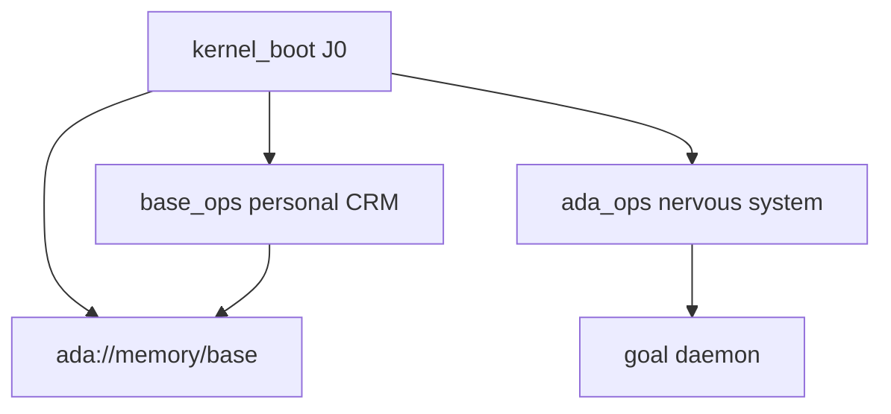

# Ada biology (silicon metaphor)

ADA treats the profile as a small organism on disk + SQLite:

| Organ        | Slug / artifact        | Function                                      |
| ------------ | ---------------------- | --------------------------------------------- |
| DNA          | `ada boot`             | Ensures hats + caches ids in `state`          |
| Personal CRM | `base_ops`             | System todos, log/recall memory (J1 primitives) |
| Nervous sys  | `ada_ops`              | Brief, tick, schedule hints (`core-ops` pack) |
| Hippocampus  | `ada://memory/base`    | Scoped knowledge items on `base_ops`          |
| Reflexes     | Chat/HUD primitives    | J2–J3 — synchronous, not goal-dequeued        |
| Circadian    | cron + `ada reload`    | J4 deploy ritual                              |

**Invariant:** `fetch_pending_task` only dequeues `task_kind='goal'`. System todos on `base_ops` stay pending under the daemon.

**Epistemics:** Ada reports what SQLite and tools return. Snapshots (`get_mission_control_snapshot`, `body_check` in J1) beat improvisation.

Hands track phases: [HANDS_PHASES.md](HANDS_PHASES.md).
