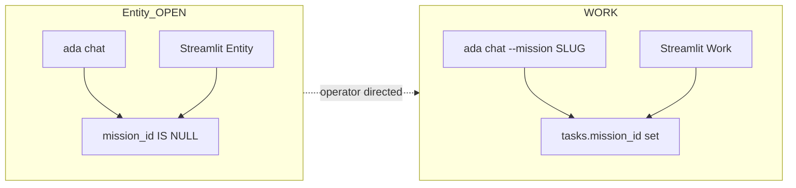

# ADA Core — Two Faces of One Entity

ADA is one operator assistant with two ingress faces. They share SQLite, master/soul, and the motor layer but differ in scope and tools.

## Two-face model

| Face | Ingress | CLI | Role |
|------|---------|-----|------|
| **Entity** | `ChatIngressMode.OPEN` | `ada chat` (no `--mission`) | Jarvis concierge: talk, weather (web), mission design (`propose_programme`), profile snapshot, guardrailed RSS sources |
| **Work** | `ChatIngressMode.WORK` | `ada chat --mission <slug>` | Programme execution: `run_skill`, ProgrammeDigest, mission-scoped graph |

There is **no** `global` or `global-graph` mission slug. Global scope means `tasks.mission_id IS NULL` plus profile-wide knowledge rows (`mission_id IS NULL`).

## Ingress resolution

See [`src/ada/chat_ingress.py`](../src/ada/chat_ingress.py):

1. `SETUP` — `ada chat --setup`
2. `WORK` — mission resolved (explicit `--mission` or Work HUD with slug)
3. `OPEN` (Entity) — default

`ada chat --programme` is **deprecated**; Entity includes `propose_programme`.

## Key modules

| Module | Purpose |
|--------|---------|
| [`chat_session.py`](../src/ada/chat_session.py) | Shared CLI + Streamlit session, tool allowlists per ingress |
| [`orchestrator.py`](../src/ada/orchestrator.py) | Gemini turns, tool dispatch |
| [`motor/`](../src/ada/motor/) | Skills, argv whitelist, `run_skill` |
| [`mission_control/`](../src/ada/mission_control/) | Snapshots, flags, ProgrammeDigest, ProfileDigest |

## Environment

| Variable | Entity | Work |
|----------|--------|------|
| `ADA_CHAT_DEFAULT_MISSION` | Ignored for plain `ada chat` | Pre-fill when `--mission` passed without slug or Work HUD |
| `ADA_ENABLE_WEB_TOOLS` | Optional factual / weather | Same |
| `ADA_ENABLE_KNOWLEDGE_TOOLS` | Subset: search, graph read, `add_knowledge_source` | Full bundle when enabled |
| `ADA_INJECT_PROFILE_DIGEST` | Turn 1 + keywords (default on) | — |
| `ADA_INJECT_PROGRAMME_DIGEST` | — | Turn 1 + keywords (default on) |

## Further reading

- [ADA_ENTITY_SLICE.md](ADA_ENTITY_SLICE.md) — Entity slice spec, tools, breaking changes
- [MEMORY_CONTRACT.md](MEMORY_CONTRACT.md) — Global kernel vs mission scope
- [CROSS_MISSION_READ.md](CROSS_MISSION_READ.md) — Profile-global knowledge rows
