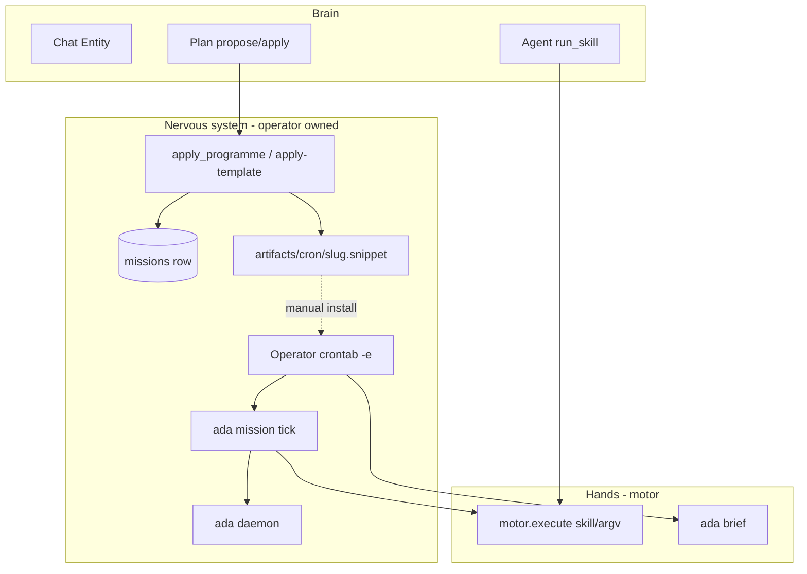

# ADA core ops — autonomic nervous system

Operator guide for **arming programmes** and running **autonomic ops** on a Pi or single profile. This doc separates what ADA does in software from what you must install and run yourself.

**North star:** Applying a programme writes a mission row and schedule hints. It does **not** mean ADA is running autonomously until you install cron, run `ada daemon`, and invoke tick/brief on schedule.

See also: [ADA_PROGRAMME_APPLY.md](ADA_PROGRAMME_APPLY.md), [PROGRAMME_TEMPLATES.md](PROGRAMME_TEMPLATES.md), [GREENFIELD_PROFILE.md](GREENFIELD_PROFILE.md), [HANDS_PHASES.md](HANDS_PHASES.md).

---

## Brain vs nervous system vs hands

| Layer | What it is | Operator surfaces |
|-------|------------|-------------------|
| **Brain** | Chat harness, digests, programme design | **Chat** (Entity concierge), **Plan** (propose/apply), **Agent** (`run_skill` / Run action) |
| **Nervous system** | Mission row, tick state, cron snippets, daemon dequeue | **Your** crontab, `ada daemon`, `ada mission tick`, `ada brief` |
| **Hands** | Motor skills, argv ops, workflows | Agent/HUD Run action, CLI motor paths, internal enqueue |

- **Brain** architecture: [ADA_CORE.md](ADA_CORE.md) (Entity vs Work).
- **Hands** architecture: [HANDS_ARCHITECTURE.md](HANDS_ARCHITECTURE.md), enforcement: [HANDS_CONTRACT.md](HANDS_CONTRACT.md), catalog: [HANDS_CATALOG.md](HANDS_CATALOG.md) / [hands_catalog.json](hands_catalog.json).



**Mental model**

- **Chat** = talk (Entity) / concierge routing.
- **Plan** = arm a programme (DB + cron snippet file).
- **Agent** = run one allowlisted action on a mission.
- **Cron + daemon** = your job; apply does not start autonomy.

---

## `ada_ops` (template `ada_ops`, pack `core-ops`)

Source: [`templates/missions/ada_ops.yaml`](../templates/missions/ada_ops.yaml). Kernel boot (`ada boot` / `ada reload`) idempotently ensures this mission plus `base_ops` (personal CRM — see [ADA_BIOLOGY.md](ADA_BIOLOGY.md)).

| Field | Value |
|-------|--------|
| Slug | `ada_ops` |
| Pack | `core-ops` |
| `skills_enabled` | `daily_brief`, `mission_tick_dry_run` |
| Purpose | Autonomic ops only — daily brief and mission tick inspection |
| Must **not** | Publish pipelines (`publish_entity_v1`, `publish_keyword_v1` are denied by pack H5) |

Template `brief_md` states: nervous-system ops for this profile — daily brief and mission tick only; no publish unless you switch to an ISR template.

Legacy Pi databases may still have a `jarvis-ops` row until the first `ada boot` (one-time rename to `ada_ops` when no collision).

This is **not** “learn my life” Entity chat and **not** ISR publish. For publish, apply `isr-publish` (or another ISR template) to a **different** mission slug.

---

## After `git pull` (deploy ritual)

No database wipe. Refresh kernel state and workers in this order:

1. **`ada boot`** — idempotent `kernel_boot`; prints `base_ops` / `ada_ops` ids and memory source id.
2. **`ada reload`** — same `kernel_boot`, then restarts the goal daemon when `ADA_RELOAD_SYSTEMD_UNIT` or `ADA_PI_SYSTEMD_SERVICE_NAME` is set (default unit name: `ada-daemon.service`). Use `--no-daemon` to skip systemctl.
3. **Restart Streamlit** — `reload` does **not** stop the HUD; exit and run **`ada hud`** (or deprecated `ada jarvis`).
4. **Verify cron** — snippet lines must target **`ada_ops`**, not `jarvis-ops`:
   - `0 7 * * * ada brief --mission ada_ops`
   - `0 6 * * 0 ada mission tick --mission ada_ops`
   Re-install from `{data_dir}/artifacts/cron/ada_ops.snippet` if you re-applied the template.

Optional env for reload:

| Variable | Role |
|----------|------|
| `ADA_RELOAD_SYSTEMD_UNIT` | Explicit unit to `systemctl restart` (overrides `ADA_PI_SYSTEMD_SERVICE_NAME`) |
| `ADA_PI_SYSTEMD_SERVICE_NAME` | Fallback unit name (e.g. `ada-daemon.service`) |
| `ADA_RELOAD_SYSTEMD_USER=1` | Use `systemctl --user restart` instead of system scope |

---

## Step-by-step: ada_ops end-to-end

### 1. Profile and env

```bash
export ADA_PROFILE=jarvis
export ADA_PROFILE_DATA_ROOT=/path/to/ada-profiles
export ADA_REQUIRE_PROFILE_ISOLATION=1
# Copy profiles/jarvis.env.example → $ADA_PROFILE_DATA_ROOT/jarvis/.env
# Set GEMINI_API_KEY, paths; greenfield uses ADA_JOB_QUEUE=system_jobs
```

See [GREENFIELD_PROFILE.md](GREENFIELD_PROFILE.md) and [`profiles/jarvis.env.example`](../profiles/jarvis.env.example) (profile dir name may stay `jarvis`; mission slug is **`ada_ops`**).

Typical ops-related variables:

| Variable | Role |
|----------|------|
| `ADA_PROFILE` / `ADA_PROFILE_DATA_ROOT` | Isolated `state.db` and `data_dir` |
| `ADA_CHAT_DEFAULT_MISSION` | Default slug for Work chat / HUD pre-fill (`ada_ops`) |
| `ADA_OPERATOR_DEFAULT_MISSION` | Optional Streamlit sidebar filter |
| `ADA_JOB_QUEUE=system_jobs` | Greenfield daemon job plane — [JOB_QUEUE_SINGLE_OWNER.md](JOB_QUEUE_SINGLE_OWNER.md) |
| `ADA_KILL_SWITCH`, `ADA_DAILY_TOKEN_BUDGET`, … | Daemon may skip dequeue when set |

Programme knobs (`project_id`, `campaign_id`, GSC URLs, matrix caps) live in **`missions.defaults_json`**, not profile `.env`. Migrate legacy env with `ada mission migrate-env ada_ops --apply`.

### 2. Ensure kernel missions

Pick one entry point:

**Kernel boot (J0 — preferred on greenfield)**

```bash
ada boot    # ensures base_ops + ada_ops + memory source; prints ids
```

**CLI apply** (updates programme fields and writes cron snippet)

```bash
ada mission apply-template ada_ops --dry-run   # preview packet JSON
ada mission apply-template ada_ops -y          # approved apply (or confirm at prompt)
```

**Streamlit Plan** — template **ada_ops**, check **Apply programme (approved)**, submit. See [STREAMLIT_BOSS.md](STREAMLIT_BOSS.md).

**Chat Plan** — `apply_programme` with `approved=true` after `propose_programme`.

Apply calls `confirm_and_apply` → `apply_packet` in `src/ada/programme/apply.py`.

### 3. After apply — operator checklist

- [ ] **Mission row** — `ada mission show ada_ops`  
  Confirm `brief_md`, `defaults_json.pack` = `core-ops`, `defaults_json.skills_enabled`, `schedule_hint_json`.
- [ ] **Cron snippet** — `{data_dir}/artifacts/cron/ada_ops.snippet`  
  `data_dir` is profile-resolved (e.g. `$ADA_PROFILE_DATA_ROOT/jarvis/data`). **Install manually:** `crontab -e` and paste lines from the snippet. Apply only writes the file.
- [ ] **Daemon** — long-running `ada daemon` (systemd on Pi). Does **not** start on apply. See [OPERATOR_LOGGING.md](OPERATOR_LOGGING.md), README §daemon.
- [ ] **Mission tick** — `ada mission tick --mission ada_ops` or `--dry-run` / `--force`. Agent skill `mission_tick_dry_run` runs the same argv (`ada mission tick --dry-run`).
- [ ] **Daily brief** — `ada brief --mission ada_ops` (cron-friendly). Optional `ada brief --enqueue` to add a pending goal for the daemon. Distinct from motor skill `daily_brief` (see below).
- [ ] **Understand apply limits** — apply does **not**: auto first tick, generate systemd units, install crontab, enqueue workflows, or call `run_skill`.

### 4. What apply does and does not do

**Does** (see [ADA_PROGRAMME_APPLY.md](ADA_PROGRAMME_APPLY.md)):

- Upsert `missions`: slug, title, `defaults_json`, `schedule_hint_json`, `brief_md`
- Merge `skills_enabled` into `defaults_json`
- Insert `knowledge_sources` from the packet
- Write `artifacts/cron/<slug>.snippet` when `recommended_cron` is set
- Append `action_log` kind `programme_apply`

**Does not:**

- Start `ada daemon` or run `ada mission tick`
- Enqueue goals/workflows or `run_skill`
- Install OS cron
- Implement `run_initial_tick` (future optional; not in tree today)

---

## Two schedulers

ADA uses **two** scheduling layers. Operators must configure both for full autonomy.

| Layer | Mechanism | Operator action |
|-------|-----------|-----------------|
| **OS cron** | Lines in `{data_dir}/artifacts/cron/{slug}.snippet` | Paste into `crontab -e`; each line is a separate one-shot `ada` process |
| **In-DB tick** | `schedule_hint_json` version 1 + SQLite `state` key `mission.tick.{slug}.{job_id}` | Run `ada mission tick --mission <slug>` on a schedule (cron or manual) |

**Tick CLI behavior** (`src/ada/mission_tick.py`):

- `--dry-run` — print due jobs only; no state update, no enqueue
- `--force` — ignore `min_interval_hours` for due calculation
- Jobs with `action.type: enqueue_goal` call motor skill **`weekly_research_goal`** with the job’s `goal_text` (not the job id name)

**Ops template quirk (document, do not rely on tick for daily brief):**  
`ada_ops.yaml` defines a tick job id `daily_brief` with `enqueue_goal`, but tick always invokes skill id `weekly_research_goal`. The snippet’s daily line correctly uses **`ada brief --mission ada_ops`**. Prefer **cron + `ada brief`** for the daily brief; use `ada mission tick --dry-run` or skill `mission_tick_dry_run` to inspect in-DB schedule due state.

**`ada brief` vs `daily_brief` skill**

| Path | What it does |
|------|----------------|
| `ada brief [--mission SLUG]` | Deterministic SQL-grounded text + artifact file; optional `--enqueue` inserts a pending **goal** for the daemon |
| Motor skill `daily_brief` | `goal_add` with SQL-grounded brief text (Agent/HUD when enabled on mission) |

Both are grounded in mission-control digest logic; the ops cron snippet uses the **CLI**.

**Legacy Pi cadence** (ingest/triage/dream) in [`ops/schedule.md`](../ops/schedule.md) is separate from mission-template snippets.

---

## ISR programmes (same machinery, different pack)

ISR missions use the same apply + snippet + tick + daemon pattern. Arm with a template, install cron, run daemon, tick on schedule.

### Dry path: `isr-research` (no publish skills)

```bash
ada mission apply-template isr-research --dry-run
ada mission apply-template isr-research -y
# Snippet: artifacts/cron/isr-research-example.snippet
ada mission tick --mission isr-research-example --dry-run
```

Allowed Agent skills on that mission: `ingest_rss_mission`, `weekly_research_goal`. Add RSS URLs to the packet before apply if you want ingest sources.

### Publish path: `isr-publish`

```bash
ada mission apply-template isr-publish --dry-run
# Edit defaults_json (project_id, campaign_id, niche) before apply if needed
ada mission apply-template isr-publish -y
```

High-risk publish skills require existing approval gates (`approved=true` on motor, env such as `ADA_REQUIRE_APPROVAL_FOR_PUBLISH` in `.env.example`). Deploy/GATE semantics: [pseo-isr-contract.md](pseo-isr-contract.md); diagnosis via `ada workflow status` and `ada gate-failures`. Without deploy keys, stay on `--dry-run` tick and dry motor paths.

**Cross-check:** `publish_keyword_v1` on mission `ada_ops` must **fail** (pack `core-ops`). Same skill on `isr-publish` mission is allowed when listed in `skills_enabled`.

---

## Mission templates (packs and cron)

Full pack allowlists: [PROGRAMME_TEMPLATES.md](PROGRAMME_TEMPLATES.md) and `src/ada/programme/packs.py`.

| Template | Default slug | Pack | `skills_enabled` | `recommended_cron` | In-DB tick jobs |
|----------|--------------|------|------------------|----------------------|-----------------|
| `ada_ops` | `ada_ops` | `core-ops` | `daily_brief`, `mission_tick_dry_run` | Daily `ada brief --mission ada_ops`; weekly `ada mission tick --mission ada_ops` | `daily_brief` (enqueue_goal) |
| `base_ops` | `base_ops` | `personal` | _(primitives only — not motor skills)_ | _(none)_ | _(none)_ |
| `isr-publish` | `isr-nz-example` | `isr-publish` | `publish_entity_v1`, `publish_keyword_v1` | Daily tick | none |
| `isr-research` | `isr-research-example` | `isr-research` | `ingest_rss_mission`, `weekly_research_goal` | Weekly tick | `weekly_goal` |
| `research` | `research` | `generic-research` | ingest + weekly | Weekly tick | `weekly_goal` |
| `job-hunt` | `job-hunt-example` | `job-hunt` | ingest + weekly | Weekly tick | `weekly_goal` |
| `archetype-minimal` | `archetype-example` | `generic-research` | ingest + weekly | _(none)_ | none |

Load any template: `ada mission apply-template <name>`.

---

## Streamlit boss UI (H7)

Primary HUD: `streamlit run scripts/ada_observability_app.py` (see [STREAMLIT_BOSS.md](STREAMLIT_BOSS.md)).

| Surface | Operator task |
|---------|----------------|
| **Chat** | Entity concierge; profile snapshot |
| **Plan** | Template picker → preview → **Apply programme** (`confirm_and_apply`) |
| **Agent** | Mission slug + **Run action** (motor `execute`, H5 enforcement) |

Apply and Run action bypass the chat loop via `ada.observability.hud_actions`. H9 may add a dedicated daily-use doc; until then use STREAMLIT_BOSS + this file.

---

## Failure modes

| Symptom | Likely cause | Where to read |
|---------|--------------|---------------|
| `skill '…' not enabled on mission` | Skill not in `skills_enabled` | [HANDS_CONTRACT.md](HANDS_CONTRACT.md) |
| `not allowed for pack 'core-ops'` | H5 pack allowlist | [HANDS_CONTRACT.md](HANDS_CONTRACT.md) |
| `programme_apply_denied` | Apply without approval | Plan/HUD checkbox or `-y` |
| `mission_tick_job_overdue` / `mission_tick_never_ran` | Tick cron not running | [mission-control-flags.md](mission-control-flags.md) |
| Goals stay `pending` | Daemon not running, kill switch, or budget cap | [OPS_DAILY.md](OPS_DAILY.md), `ADA_KILL_SWITCH` |
| Publish workflow despite ops pack | Workflow enqueue bypasses motor H5 | [HANDS_CONTRACT.md](HANDS_CONTRACT.md) § Bypass |

Run `ada doctor` for daily flags ([OPS_DAILY.md](OPS_DAILY.md)).

---

## Verification appendix (manual)

After implementing or changing ops docs, on a greenfield profile:

1. `ada boot` then `ada mission apply-template ada_ops -y` (or Streamlit Plan with approved).
2. Inspect `{data_dir}/artifacts/cron/ada_ops.snippet` — expect two cron lines targeting **`ada_ops`**.
3. `ada mission tick --mission ada_ops --dry-run` — schedule-aware dry output.
4. `ada brief --mission ada_ops` — brief on stdout; `# artifact: …` on stderr.
5. Agent/HUD: `publish_keyword_v1` on `ada_ops` → motor error (see `tests/test_skills_enabled_enforcement.py`).
6. `ada mission apply-template isr-research -y` then `ada mission tick --mission isr-research-example --dry-run` only (no live publish required).

---

## Manual smoke on Pi (J-track, after J4)

Assumptions: profile env from [`profiles/jarvis.env.example`](../profiles/jarvis.env.example), `ADA_JOB_QUEUE=system_jobs`, daemon under systemd or tmux.

1. **Boot / doctor** — `ada boot` prints `base_ops` / `ada_ops` ids; `ada doctor` exits 0.
2. **Kernel idempotency** — run `ada boot` twice; no duplicate missions or memory sources.
3. **Entity chat (NULL task mission)** — `ada chat` → “remember …” / “list todos” / “body check” use `run_primitive` (not `run_skill`).
4. **Daemon isolation** — system todo on `base_ops` stays `pending` while `ada daemon` runs.
5. **Autonomic ops** — `ada brief --mission ada_ops`; `ada mission tick --mission ada_ops`; `ada dream` if configured.
6. **HUD** — `ada hud` (preferred); home chips for memory/todo/body check; Agent panel runs `daily_brief` on `ada_ops`.
7. **Deploy ritual** — `git pull` → `ada boot` → `ada reload` → restart Streamlit → verify cron targets `ada_ops`.
8. **Reload safety** — `state.db` mission row counts unchanged; only kernel state keys refreshed.

---

## Related docs

- [ADA_PROGRAMME_APPLY.md](ADA_PROGRAMME_APPLY.md) — apply semantics
- [STREAMLIT_BOSS.md](STREAMLIT_BOSS.md) — Chat / Plan / Agent HUD
- [operator-runbook-raspberry-pi.md](operator-runbook-raspberry-pi.md) — Pi systemd and env matrix
- [JOB_QUEUE_SINGLE_OWNER.md](JOB_QUEUE_SINGLE_OWNER.md) — daemon job plane
- [HANDS_PHASES.md](HANDS_PHASES.md) — Hands phase index (H8 complete, H9 Streamlit polish)
