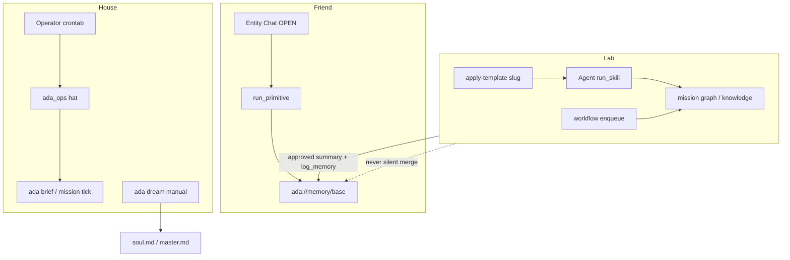

# ADA entity buckets — Friend, House, Lab

**North star:** ADA is one personal entity with three **operator buckets** (not three codebases). Each bucket maps to mission **hats**, tool classes, and memory pools. Extend capabilities in order: **primitive → skill → goal/cron → workflow**. Do not add a mission slug per small habit.

See bucket detail: [buckets/FRIEND.md](buckets/FRIEND.md) · [buckets/HOUSE.md](buckets/HOUSE.md) · [buckets/LAB.md](buckets/LAB.md).

Tooling: [TOOL_EXTENSION_GUIDE.md](TOOL_EXTENSION_GUIDE.md) · Memory: [MEMORY_OPS.md](MEMORY_OPS.md) · Use cases: [use_cases/README.md](use_cases/README.md).

---

## Architecture



---

## Master table

| Bucket | Purpose | Mission slug(s) | Allowed tool classes | Forbidden | Cron owner |
|--------|---------|-------------------|----------------------|-----------|------------|
| **Friend** | Personal concierge: voice, todos, base memory | `base_ops` (kernel) | Entity Chat: `run_primitive` allowlist; read tools (`search_knowledge`, snapshots, `propose_programme`) | `run_skill`; motor workflows; graph writes in Entity; inventing counts | None |
| **House** | Autonomic ops: brief, tick, dream, optional NULL ingest | `ada_ops` | Agent `run_skill` on ops pack; CLI `ada brief`, `ada mission tick`, `ada dream` | Publish/ISR on default ops; matrix/GSC on `ada_ops` cron; Chat `enqueue_workflow` | **Operator** (external crontab) |
| **Lab** | Programmes: research, job hunt, ISR (later) | Per-template slug (e.g. `research`, `job-hunt-example`) | `ada mission apply-template`; Agent `run_skill`; workflow enqueue ([HANDS_CONTRACT](HANDS_CONTRACT.md) bypass) | Silent merge into base memory; new slug per habit | Operator per mission snippet |

---

## Friend

| | |
|--|--|
| **Surface** | Entity Chat only (`ada chat`, HUD Chat, NULL `tasks.mission_id`) |
| **Hat** | `base_ops` — personal CRM ([`templates/missions/base_ops.yaml`](../templates/missions/base_ops.yaml)) |
| **Motor** | `run_primitive` — closed IDs in [`src/ada/primitives/catalog.py`](../src/ada/primitives/catalog.py) |

| Primitive | Hat | Role |
|-----------|-----|------|
| `add_task`, `list_tasks`, `complete_task` | `base_ops` | System todos |
| `log_memory`, `recall_memory` | `base_ops` | `ada://memory/base` — personal notes |
| `body_check` | `ada_ops` | Health snapshot (routing in Chat per concierge note) |

**Memory split** ([MEMORY_CONTRACT.md](MEMORY_CONTRACT.md)): `log_memory` / `recall_memory` → personal base pool. `search_knowledge` / `get_entity_graph_context` → NULL kernel and profile-wide ingest — not interchangeable for “remember this about me.”

**Never:** `run_skill` in Chat; `enqueue_workflow` from concierge; guessing job/workflow counts.

Detail: [buckets/FRIEND.md](buckets/FRIEND.md).

---

## House

| | |
|--|--|
| **Surface** | `ada_ops` mission; cron + daemon + Agent/HUD Run action |
| **Hat** | `ada_ops` — pack `core-ops` ([`templates/missions/ada_ops.yaml`](../templates/missions/ada_ops.yaml)) |
| **Skills** | `daily_brief`, `mission_tick_dry_run` |

Copy-safe cron (from template; install manually):

```cron
0 7 * * * ada brief --mission ada_ops
0 6 * * 0 ada mission tick --mission ada_ops
```

- **`ada dream`:** manual or operator cron — transcript → soul/master ([MEMORY_OPS.md](MEMORY_OPS.md)); not graph enrichment.
- **`ingest-rss`:** optional on **NULL** kernel when scheduled — not part of default `ada_ops` template `knowledge_sources`.

**Never:** publish/ISR pipelines on default `ada_ops`; GSC/matrix on House cron; autonomous “learn everything” without programme boundaries.

Detail: [buckets/HOUSE.md](buckets/HOUSE.md). Runbook: [ADA_CORE_OPS.md](ADA_CORE_OPS.md).

---

## Lab

| | |
|--|--|
| **Surface** | `ada mission apply-template <name>`; `ada chat --agent --mission <slug>`; workflows |
| **Hat** | One slug per **programme** (folder/template), not per feature |
| **Skills / workflows** | Pack allowlist + `skills_enabled`; workflows bypass H5 motor gate |

Workflow enqueue (`ada workflow enqueue`, internal enqueue) does **not** pass `skills_enabled` enforcement — see [HANDS_CONTRACT.md](HANDS_CONTRACT.md) § Bypass (out of H5 scope).

**GSC:** set `defaults_json.gsc_site_url` per mission ([`templates/missions/research.yaml`](../templates/missions/research.yaml)); mission wins over deprecated env `GSC_SITE_URL`.

**ISR:** defer until daily House loop (brief + tick) is stable.

Detail: [buckets/LAB.md](buckets/LAB.md). Templates: [PROGRAMME_TEMPLATES.md](PROGRAMME_TEMPLATES.md).

---

## Bridge rule (Lab → Friend)

Mission graph and Lab knowledge stay **mission-scoped** until the operator explicitly bridges:

1. Review Lab output.
2. Approve a short text summary.
3. Friend: `log_memory` with tag `lab-summary` ([MEMORY_OPS.md](MEMORY_OPS.md)).

**Never:** silent graph→base merge; broad `ada consolidate`; automatic promotion of mission rows to `ada://memory/base`.

---

## Related docs

| Doc | Role |
|-----|------|
| [ADA_PERSONA.md](ADA_PERSONA.md) | Voice, data-first epistemics |
| [ADA_BIOLOGY.md](ADA_BIOLOGY.md) | Kernel hats metaphor |
| [ADA_CORE.md](ADA_CORE.md) | Entity vs Work |
| [ADA_CORE_OPS.md](ADA_CORE_OPS.md) | Autonomic ops, Pi smoke |
| [HANDS_CONTRACT.md](HANDS_CONTRACT.md) | H5 enforcement, bypass, routing |
| [MEMORY_CONTRACT.md](MEMORY_CONTRACT.md) | Scope contract |
| [SKILL_SPEC.md](SKILL_SPEC.md) | Motor skill schema |
| [HANDS_PHASES.md](HANDS_PHASES.md) | Phase index (K0) |
