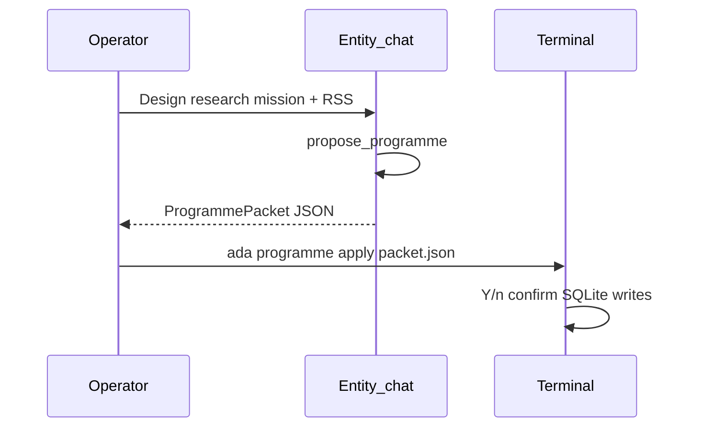

# ADA Entity Slice — OPEN / Global Concierge

Entity ingress is `ChatIngressMode.OPEN` (operator label **entity**). It is the Jarvis concierge face: conversational help, mission design, and guardrailed profile writes — not programme execution.

## Gap resolved (summary)

| Before | After |
|--------|-------|
| OPEN allowed `run_skill` | Entity denies `run_skill` |
| OPEN had no snapshot / propose | Profile snapshot tool + `propose_programme` |
| `ADA_CHAT_DEFAULT_MISSION` forced WORK on plain `ada chat` | Plain `ada chat` is always Entity |
| Streamlit `work`/`programme` radio | `entity` / `work` (default entity) |

## Tool allowlist (closed set)

### Allow

- `check_token_usage`
- `get_mission_control_snapshot` (profile_scope, `mission_id=None`)
- `propose_programme`
- `run_allowlisted_shell` (read-only)
- `append_master_section`, `append_soul_fragment` (if memory tools on)
- `web_search`, `fetch_url_text` (if `ADA_ENABLE_WEB_TOOLS=1`)
- `search_knowledge`, `get_entity_graph_context` (if knowledge on)
- `add_knowledge_source` (rss/web, host allowlist, audited)

### Deny

- `run_skill` — redirect to `ada chat --mission <slug>`
- `enqueue_workflow`, plan tools, file sandbox (Entity session)
- `record_entity`, `record_edge`, `link_evidence`, `record_synthesis`, `record_market_edge`
- Raw `defaults_json` in system prompt

## Read → propose → apply

Mission template apply remains `ada mission apply-template` (not a chat tool).

## Profile digest

`build_profile_digest` injects on turn 1 and intent keywords (`mission`, `schedule`, `flag`, `weather`, `rss`, …). Max ~1.5KB. Env: `ADA_INJECT_PROFILE_DIGEST=1` (default).

Full snapshot is available via tool on demand — not injected every turn.

## CLI

| Command | Mode |
|---------|------|
| `ada chat` | Entity |
| `ada chat --mission SLUG` | Work |
| `ada chat --programme` | Deprecated → Entity + stderr warning |

### Breaking: `ADA_CHAT_DEFAULT_MISSION`

Only applies when:

- `ada chat --mission` is passed (slug may come from env if empty), or
- Streamlit **Work** tab with env prefill

Plain `ada chat` **ignores** this variable.

## Streamlit HUD

Chat tab: **Entity** (default) | **Work**. Work requires mission slug. Programme apply stays terminal-only (`ada programme apply`).

## Security

- No secrets or `defaults_json` bodies in Entity system prompt
- Writes via motor closed mutations + programme schema only
- Web tools: existing SSRF / host caps

## Tests (no Gemini)

- `tests/test_entity_tools.py` — OPEN declarations exclude `run_skill`
- `tests/test_profile_digest*.py` — digest size and inject
- `tests/test_entity_mission_env.py` — env default semantics
- `tests/test_entity_work_regression.py` — WORK flags unchanged

## Phase F (future)

- HUD **programme apply** button with Y/n confirm (motor closed set only)
- Proactive **switch to WORK** nudges from profile flags (overdue tick, pending goals)
- Optional `ADA_ENTITY_WEB=1` — concierge-only web stack separate from full `ADA_ENABLE_WEB_TOOLS`
