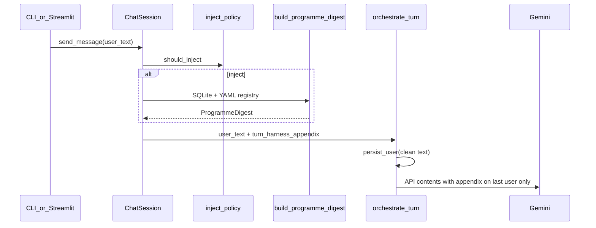

# ADA Phase D — Grounded mission chat (thin harness)

Prerequisite: [ADA_PHASE_C.md](ADA_PHASE_C.md) gate green; operator validated jarvis profile.

Phase D answers programme/schedule/status questions from **SQL/YAML truth** without magic English prompts or forcing a 12KB snapshot every turn.

## Operator defaults

| Topic | Default |
|-------|---------|
| Context injection | First user turn + intent keywords |
| Digest max bytes | 1500 (`PROGRAMME_DIGEST_MAX_BYTES`) |
| Full snapshot auto | Off — `get_mission_control_snapshot` tool remains |
| Streamlit chat | New HUD thread completes prior chat `tasks` row |
| Env | `ADA_INJECT_PROGRAMME_DIGEST=1` (on) for WORK + mission |

## Gap matrix

| Area | Before | After |
|------|--------|-------|
| Tool discipline | Model often skipped snapshot | ProgrammeDigest injected; snapshot for refresh |
| Snapshot richness | Job ids only in overview | Optional `programme` block with schedule semantics |
| Token budget | None per turn | ~1500 B digest on turn 1 + status questions |
| Streamlit lifecycle | Unbounded `executing` chat tasks | Prior task `completed` on session key change |
| Harness audit | Stale “setup only” status row | WORK digest + tool ([HARNESS_AUDIT.md](HARNESS_AUDIT.md)) |

## Turn flow



## ProgrammeDigest schema

Built by `build_programme_digest(conn, mission_id)` in `src/ada/mission_control/programme_digest.py`.

| Field | Source |
|-------|--------|
| `schedule_jobs[]` | `schedule_hint_json` v1 + `state` tick keys |
| `skills[]` | `defaults_json.skills_enabled` + `skills/*.yaml` |
| `task_status_counts`, `workflow_status_counts` | SQL aggregates |
| `flags_top_n[]` | `collect_flags` (id, severity, message only) |

No raw `defaults_json`, payloads, or secrets.

## Injection policy

Inject when:

1. `ChatIngressMode.WORK` and `mission_id` set
2. `ADA_INJECT_PROGRAMME_DIGEST` enabled (default on)
3. First user turn **or** message matches intent regex (`schedule`, `mission`, `job`, `tick`, `brief`, `status`, `flags`, `programme`, `cron`, `daily_brief`, `overdue`, `never ran`)

Implementation: `src/ada/mission_control/inject_policy.py`, `ChatSession.send_message`, `orchestrate_turn(turn_harness_appendix=...)`.

## Token budget (jarvis-ops typical)

| Payload | Size | ~Tokens |
|---------|------|---------|
| ProgrammeDigest (2 jobs, 2 skills) | 800–1200 B | 200–350 |
| Cap | 1500 B | ~400–500 |
| Full snapshot | up to 12_000 B | ~2500–3500 |

## Environment

```bash
# .env — see .env.example
ADA_INJECT_PROGRAMME_DIGEST=1
# ADA_PROGRAMME_DIGEST_MAX_BYTES=1500  # optional future; default in code
```

## Manual validation (D8)

```bash
export ADA_PROFILE=jarvis ADA_CHAT_DEFAULT_MISSION=jarvis-ops
ada chat --mission jarvis-ops --new-session
# Q1: What does daily_brief do?
# Q2: When does the tick run for daily_brief?
# Q3: What's 2+2?   # no digest inject (no intent on turn 2+)
# Q4: Full status please — should call get_mission_control_snapshot; facts match Q1–Q2
```

Streamlit: Chat tab → Q1–Q2 → enable **New session** → confirm HUD does not accumulate `executing` chat tasks.

## Acceptance

- Plain English schedule/skill questions answered from digest without “I can’t access”
- Explicit snapshot still works and matches digest
- Streamlit session rotation completes old chat tasks
- `pytest tests/test_programme_digest.py tests/test_programme_digest_inject.py tests/test_harness_contract.py tests/test_prompt_harness.py tests/test_phase_b_smoke.py tests/test_phase_c_smoke.py -q`

## See also

- [ADA_CORE.md](ADA_CORE.md)
- [HARNESS_AUDIT.md](HARNESS_AUDIT.md)
- [ADA_PHASE_C.md](ADA_PHASE_C.md)

## Phase E (deferred)

- Classifier model for inject trigger
- HUD ProgrammeDigest sidebar
- Auto-notify on flags
- CLI exit completes chat task
