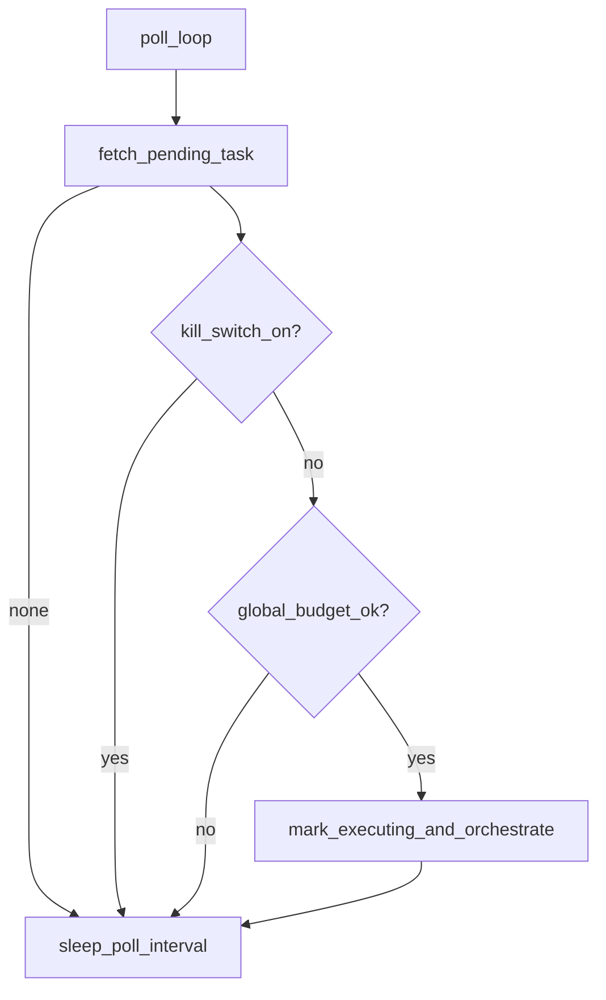

# ADA — Apex OS / Intelligence Factory Roadmap

**Status:** Planning document — tweak sources, vendors, and phase boundaries as needed.  
**Audience:** Implementers extending the existing ADA codebase.  
**Normative harness behavior** remains defined in [`claude_logic.md`](claude_logic.md); this roadmap adds **product-level** capabilities on top.

---

## 1. Purpose

This file is the **implementation blueprint** for evolving ADA from a **daemon + SQLite knowledge stack** into a **governed intelligence and execution layer**: batched market signals (keywords, tenders, gov APIs, RSS), **structured memory** (graph-lite + citations), **workflow decomposition** (parent goals → child tasks), **tiered synthesis**, optional **web artifacts**, and **measurement loops** — with **budgets, allowlists, sandboxes, and human gates** so the system stays cheap, factual, and controllable.

**You may change:** data providers, cron schedules, model names, and which phases ship first.  
**Keep stable:** contracts (JSON schemas), state machine rules, separation of **control plane (Python)** vs **judgment plane (LLM)**.

---

## 2. Relationship to current codebase

| Area | Today (baseline) | This roadmap extends |
|------|------------------|------------------------|
| Daemon / tasks | `tasks`, `messages`, `orchestrator.py` | Parent workflows, child tasks, idempotency |
| SQLite | `src/ada/db/schema.sql` + `_migrate_schema` in `persistent/store.py` | New tables below; always migrate, never break existing rows |
| Knowledge | `knowledge_sources`, `knowledge_items`, FTS5, optional embeddings | Raw ingest, entities/edges, experiments, artifacts |
| Business kernel | `knowledge_synthesis`, `market_metrics`, `synthesis_edges`, triage | Stricter rules + graph + episodic outcomes |
| Tools | `tools/registry.py`, `tool_executor.py` | New tools with JSON-only contracts |
| Config | `config.py` / env | Budgets, kill switch, commercial `DATA_DIR`, API keys |
| Docs | `docs/system_architecure.md` (Phase 1 MVP) | Superseded for *new* features by this roadmap’s phases |

---

## 3. Design principles (non-negotiable)

1. **Deterministic control plane:** Routing, retries, dedupe, allowlists, schema validation, workflow state — **Python/SQL**, not LLM.
2. **Judgment plane bounded:** LLMs do **extraction, classification, and synthesis** only on **retrieved or fetched text**, with **strict JSON outputs** and **citation IDs** where claims are made.
3. **No silent mixing:** Keyword demand signals, news/policy items, and procurement events stay **separate rows** until an explicit **join job** links them with **evidence pointers**.
4. **Cost is a first-class input:** Per-task and global **token/call budgets**; **tiered models**; **batch** expensive APIs (e.g. keyword volume) — never daily full-universe pulls.
5. **Human gates for irreversible or risky actions:** Deploy to public web, outbound email to third parties, payments — require **explicit approval records** in SQLite.
6. **Provenance everywhere:** Every ingested or derived fact traceable to **source_id**, **URI**, **content_hash**, **fetched_at**.

---

## 4. Phase overview

| Phase | Name | Goal |
|-------|------|------|
| 0 | Control plane & budgets | Kill switch, caps, audit, no new market surface |
| 1 | Deterministic ingest | RSS/config, keyword batch, gov API clients → `raw` + `knowledge_items` |
| 2 | Graph-lite & extraction | Entities/edges + evidence links; validators |
| 3 | Workflow engine | Parent goal → child tasks (DAG-ish), planner, idempotency |
| 4 | Dual reports & approval | Intel brief + execution brief; `approvals` for publish |
| 5 | Web artifacts | Templated pages/PDF/forms; deploy behind gate |
| 6 | Measurement & pruning | Events, experiments, rollups, retention |
| 7 | Outbound & monetization (optional) | Extra gates; not required for intel MVP |

Phases can **overlap in calendar time** but **dependencies** should be respected: **0 before everything**; **1 before 2**; **2 before 3** if planner emits extract steps; **4 before 5** if deploy reads approved artifacts.

---

## 5. Phase 0 — Control plane, budgets, kill switch (harness-ready)

This section is **normative** for behavior implemented in the repo: [`src/ada/main.py`](src/ada/main.py) (`ada daemon`), [`src/ada/budget.py`](src/ada/budget.py), [`src/ada/config.py`](src/ada/config.py), [`src/ada/persistent/store.py`](src/ada/persistent/store.py) (`get_global_usage_token_totals_utc`), [`src/ada/query_engine.py`](src/ada/query_engine.py). Per-session limits remain in [`src/ada/orchestrator.py`](src/ada/orchestrator.py).

### 5.1 Objectives

- **Per-session** token ceiling (existing) plus **global** daily/monthly caps across all sessions from `usage_ledger`.
- **`ada daemon` kill switch**: stop dequeuing goals without mutating queued rows.
- **Audit**: throttle-friendly `action_log` entries for blocks.
- **Config hooks**: commercial data directory (isolated `state.db`), `ADA_MAX_TASK_STEPS` reserved for Phase 3.

### 5.2 Baseline inventory (already in codebase)

| Mechanism | Location | Behavior |
|-----------|----------|----------|
| Per-session token ceiling | `orchestrator.py` (`SessionTokenLimitExceeded`), `ADA_MAX_SESSION_TOKENS` | After each model leg, sum `usage_ledger` for `session_id`; on exceed → `action_log` `session_token_limit_exceeded`, task `failed`. |
| Usage persistence | `PersistentState.record_usage` / `get_session_token_usage` | Per-leg rows; sum is an **operational upper bound** (multi-leg overlap caveat in docstring). |
| Global UTC totals | `PersistentState.get_global_usage_token_totals_utc` | Sums **all** sessions for current UTC calendar day and month. Same caveat as session sums. |
| Tool rounds | `ADA_MAX_TOOL_ROUNDS` | `legs_cap` in orchestrator. |
| `check_token_usage` | `tools/registry.py`, `tool_executor.py` | Session-scoped totals for the model. |
| Daemon dequeue | `main.py` `run_daemon_loop` | After Phase 0: precheck **before** `status=executing`. |

### 5.3 Kill switch (normative)

- **Env:** `ADA_KILL_SWITCH` — `1`, `true`, `yes`, `on` (case-insensitive) → on; unset / `0` / other → off.
- **Behavior:** When on, the daemon **does not** call `update_task(..., executing)` for the pending goal. The task **stays `pending`**. **`ada goal add`** and other CLI enqueue paths are **unchanged** (only the long-running worker is paused).
- **Logging:** `action_log` kind **`kill_switch_skip`**, at most **once per UTC day** (state key `daemon.log.kill_switch.<YYYY-MM-DD>`) to avoid log spam every poll interval.

### 5.4 Global budgets (normative)

- **Env:** `ADA_DAILY_TOKEN_BUDGET`, `ADA_MONTHLY_TOKEN_BUDGET` — optional **positive integers**; unset = **no limit** for that dimension.
- **Definition:** Sum `COALESCE(input_tokens,0)+COALESCE(output_tokens,0)` over **all** `usage_ledger` rows where `date(recorded_at)` matches the **current UTC date**, or `strftime('%Y-%m', recorded_at)` matches the **current UTC year-month**.
- **When checked:** Once per dequeue, **before** marking the goal `executing` (v1 — dequeue gate only).
- **On exceed:** Do **not** start the task; leave **`pending`**. **Do not** set `failed` (distinct from per-session `ADA_MAX_SESSION_TOKEN` breach mid-turn). **`action_log` kind `global_budget_block`** with payload `scope`, `used`, `limit`, `utc_date` / `year_month`, throttled **once per UTC day per scope** via state keys `daemon.log.budget.daily.<date>` / `daemon.log.budget.monthly.<date>`.

### 5.5 Dequeue ordering



### 5.6 Commercial data directory

- **Env:** `ADA_COMMERCIAL_DATA_DIR` — optional directory path.
- **Behavior:** When set, `Settings.load()` uses it as **`ADA_DATA_DIR`** for that process (`state.db` = `<dir>/state.db`). **Recommended** for isolating Apex/commercial SQLite from a personal `data/` tree. `memory/` and project root still follow existing layout.

### 5.7 `ADA_MAX_TASK_STEPS`

- Parsed as a positive integer when set; stored on `Settings` as **`ada_max_task_steps`**. **No enforcement** in Phase 0 — reserved for Phase 3 workflow steps.

### 5.8 Provenance / audit (`action_log`)

| Kind | When |
|------|------|
| `kill_switch_skip` | Daemon skipped dequeue due to kill switch (throttled daily). |
| `global_budget_block` | Daemon skipped dequeue due to daily or monthly global cap (throttled daily per scope). |
| `session_token_limit_exceeded` | Existing — per-session cap during a turn (orchestrator). |

### 5.9 Configuration reference

| Variable | Default | Semantics |
|----------|---------|-----------|
| `ADA_KILL_SWITCH` | off | Daemon does not execute pending goals when on. |
| `ADA_DAILY_TOKEN_BUDGET` | unset | Global UTC day token sum cap (input+output). |
| `ADA_MONTHLY_TOKEN_BUDGET` | unset | Global UTC month token sum cap. |
| `ADA_COMMERCIAL_DATA_DIR` | unset | If set, used as `data_dir` / `state.db` root. |
| `ADA_MAX_SESSION_TOKENS` | `50000` | Per task session; **fails** task when exceeded mid-run (unchanged). |
| `ADA_MAX_TASK_STEPS` | unset | Reserved; Phase 3. |

### 5.10 Integration points (code)

| File | Role |
|------|------|
| [`src/ada/budget.py`](src/ada/budget.py) | `daemon_should_execute_goal`, `maybe_log_daemon_block`. |
| [`src/ada/main.py`](src/ada/main.py) | Precheck after `fetch_pending_task`, before `executing`. |
| [`src/ada/config.py`](src/ada/config.py) | Parses Phase 0 env into `Settings`. |
| [`src/ada/persistent/store.py`](src/ada/persistent/store.py) | `get_global_usage_token_totals_utc`. |

### 5.11 Acceptance criteria

- [x] Kill switch on → no goal transitions to `executing`; tasks remain `pending`.
- [x] Global daily/monthly caps use UTC and `usage_ledger` sums.
- [x] Global cap block does **not** mark tasks `failed`.
- [x] Per-session `ADA_MAX_SESSION_TOKENS` behavior unchanged.
- [x] Tests cover budget helpers and global SQL totals (see `tests/test_phase0_budget.py`).

### 5.12 Non-goals (Phase 0)

- No deploy/outbound tools.
- No new SQLite tables for budgets (derive from `usage_ledger` + `state` throttle keys only).
- No per-leg global budget check inside `_agentic_loop` (optional v2).

### 5.13 Test matrix (implemented)

| Test | Location |
|------|----------|
| `global_budget_blocks`, `daemon_should_execute_goal` | `tests/test_phase0_budget.py` |
| `get_global_usage_token_totals_utc` (today vs past `recorded_at`) | `tests/test_phase0_budget.py` |

---

## 6. Phase 1 — Deterministic ingest (batch keywords, RSS, gov APIs)

### 6.1 Objectives

- **Keyword API:** Infrequent **batch** jobs (weekly/monthly or manual trigger), persist full response snapshot, then **filter in code** (locale, category, min volume if present). Never pass 100k terms into an LLM.
- **RSS:** Continue / extend `ingest/rss` patterns; each feed registered in `knowledge_sources` with **rich config** (see tagging).
- **Government / open data APIs:** Thin Python modules per API family; **allowlisted hosts**; results stored as `knowledge_items` **or** `ingest_raw` first then normalized.

### 6.2 Feed & source tagging (contract)

Extend config (YAML/JSON or DB) per source:

```json
{
  "source_key": "rnz_business",
  "kind": "rss",
  "base_url": "https://…",
  "trust_tier": "news",
  "region": "NZ",
  "topics": ["economy", "policy"],
  "cadence_minutes": 60,
  "maps_to": "knowledge_items.policy_news"
}
```

Per **gov API** (example shape):

```json
{
  "api_key": "gets_opportunities",
  "base_url": "https://…",
  "auth": "none | api_key_header | oauth",
  "rate_limit_rpm": 60,
  "maps_to": "knowledge_items.procurement",
  "normalizer": "ada.ingest.gets.normalize_opportunity"
}
```

**Catalog table** (recommended): see §12.2 `source_catalog` — maps **human intent** → **fetcher** → **DB shape**.

### 6.3 Harness rules

- **HTTP:** Timeouts, max bytes, per-host rate limits (reuse patterns from `config.py` web/ingest settings).
- **Dedupe:** `content_hash` + canonical URL (already partially used); for APIs use stable `external_id`.
- **Gatekeeper:** Optional LLM gate on ingest (`ingest_gatekeeper` already exists) — keep **cheap model** and **strict max output tokens**.

### 6.4 Allowlists

- `knowledge_feed_host_allowlist` (existing) — extend for new RSS hosts.
- New: `ADA_GOV_API_HOST_ALLOWLIST` — comma-separated or file.

### 6.5 Noise control

- Ingest path: **fetch → normalize → hash → optional rule filter → optional small classifier → store**.  
- **Do not** run full “synthesize the web” on every row. Deep synthesis is **Phase 4** and **tiered**.

### 6.6 New / extended tools (optional agent-facing)

Prefer **cron-first** implementations calling `PersistentState` directly; expose **thin tools** only when the chat agent must trigger:

| Tool name | Responsibility | JSON contract (result) |
|-----------|----------------|-------------------------|
| `enqueue_ingest_job` | Queue `ingest_job` row | `{ "job_id": 123 }` |
| `fetch_source_catalog` | List configured sources | `{ "sources": [ … ] }` |

### 6.7 Env vars (add as needed)

| Variable | Purpose |
|----------|---------|
| `KEYWORD_API_KEY` / vendor-specific | Keyword provider |
| `KEYWORD_BATCH_CRON` | Schedule hint (actual cron in `ops/` or system) |
| `ADA_KEYWORD_MAX_TERMS_PER_RUN` | Hard cap |
| `GETS_API_*` or `DATA_GOVT_*` | Per API |

### 6.8 Schema additions (see §12)

- `ingest_jobs`, `ingest_raw` (optional but recommended for audit replay)

### 6.9 Tests

- Mock HTTP; allowlist blocks unknown host; oversized body rejected; dedupe skips second insert; `KnowledgeItemInsertResult.inserted` behavior preserved.

---

## 7. Phase 2 — Graph-lite memory & extraction

### 7.1 Objectives

- Represent **entities** (company, niche, region, product category) and **edges** (e.g. NEEDS, SUPPLIES, REGULATED_BY) with **evidence** links to `knowledge_items` or `ingest_raw` rows.
- Replace ad-hoc prose in prompts with **queryable structure** for planner and reporting.

### 7.2 Relationship to existing kernel tables

- Today: `market_metrics` + `synthesis_edges` link metrics to news-like `knowledge_items`.
- Graph-lite **generalizes** beyond numeric metrics: edges may be **qualitative** if **policy text evidence** exists (align with triage prompts: `record_market_edge` only with numeric evidence; qualitative → edge type without numeric metric, or separate `edge_evidence` only).

### 7.3 Harness rules

- Tools **`record_entity`**, **`record_edge`** validate JSON server-side; **reject** missing evidence IDs for non-“hypothesis” edges (configurable).
- **Extraction jobs:** single niche or single document batch per job; **token cap** per job.

### 7.4 New tools (declarations in `registry.py`, handlers in `tool_executor` / store)

| Tool | Input schema (required keys) | Notes |
|------|------------------------------|-------|
| `record_entity` | `name`, `type` (enum), `aliases?`, `external_ids?` | Upsert by normalized name + type |
| `record_edge` | `src_entity_id`, `dst_entity_id`, `edge_type` (enum), `confidence`, `evidence_item_ids` | FK to knowledge_items |
| `link_evidence` | `edge_id`, `knowledge_id`, `quote_span?` | Optional character span in excerpt |

**JSON-only responses** from LLM extractors; **no** long markdown in automated paths.

### 7.5 Schema — see §12.3

### 7.6 Tests

- Reject edge without evidence when policy requires it.
- Merge duplicate entities.
- Tombstone `knowledge_items` does not delete edges without cascade policy (define: soft-delete edges or mark invalid).

---

## 8. Phase 3 — Workflow engine (parent goals, child tasks, planner)

### 8.1 Objectives

- Replace one-shot giant goals with **`workflows`**: a **parent** record and **ordered/dependent child tasks** (`FETCH`, `EXTRACT`, `SYNTHESIZE`, `DRAFT_BRIEF`, later `DEPLOY`).
- Support **idempotency** and **retries** for long runs.

### 8.2 Child task types (enum — extend only in code)

| Type | Typical inputs | Runtime (implementation) |
|------|----------------|-------------------------|
| `FETCH` | RSS / sources | `ingest_rss_feeds` — no LLM |
| `EXTRACT` | `recent_item_limit` + graph | `orchestrate_turn` + `record_entity` / `record_edge` tool subset |
| `SYNTHESIZE` | topic | `orchestrate_turn` + `search_knowledge` / `record_synthesis` tool subset |
| `ENRICH` | `entity_id` | `ada/publish/enrich.py` — knowledge + `graph_edges` + `source_url` / `last_enriched_at` |
| `GATE` | `entity_id` | `count_unique_local_facts` vs `ADA_PUBLISH_MIN_UNIQUE_FACTS` — no LLM |
| `DRAFT` | `entity_id` + `project_id` + `campaign_id` + `niche` + optional `slug` | `ada/publish/draft.py` — Gemini JSON → `PageJsonV1` |
| `DEPLOY` | same + prior DRAFT page | `ada/publish/s3_publish.py` — `page.json` + `manifest.json` |
| `DRAFT_BRIEF` | (legacy / alternate) | Not implemented — use `DRAFT` for pSEO |

**Capability matrix (code):** `ada/workflow/steps.WORKFLOW_VALID_STEP_TYPES` — `schema.sql` and workflow_steps migration must stay in sync. **S3/ISR field contract:** `docs/pseo-isr-contract.md` + `ada/publish/page_schema_v1.py`.

Planner may be **template-driven** (v1, deterministic) or **LLM-assisted** (v2) with **hard enum** of child types — planner **cannot** invent new types without a code deploy.

### 8.3 Harness rules

- `enqueue_workflow` creates parent + children; **max children**, **max depth**, **dead-letter** after N failures.
- **Idempotency key:** `(workflow_kind, input_hash)` prevents duplicate runs.

### 8.4 Gates

- Planner runs **inside daemon** or dedicated worker — not arbitrary chat turns without budget.

### 8.5 New tools

| Tool | Purpose |
|------|---------|
| `enqueue_workflow` | Agent or CLI inserts parent goal row + `workflow` |
| `get_workflow_status` | Read-only status for operator |

### 8.6 Schema — §12.4

### 8.7 Tests

- DAG cycle detection rejected.
- Retry does not duplicate completed children (idempotency).
- Forbidden tool from wrong child type fails closed.

---

## 9. Phase 4 — Dual outputs, human approval, delivery

### 9.1 Objectives

- **Report A — Intelligence:** Grounded summary with **citations** (`ref_item_ids` pattern as in `knowledge_synthesis`).
- **Report B — Execution brief:** One-page plan (landing angle, assets, risks, **next command or workflow** to run) — still stored as **artifact**, not chat-only.
- **Approval** before any public deploy or paid API blast.

### 9.2 Delivery channels (implement any subset)

| Channel | Mechanism |
|---------|-----------|
| File | `artifacts` row + path under `ADA_COMMERCIAL_DATA_DIR/reports/` |
| Notification | Webhook `ADA_REPORT_WEBHOOK_URL` (POST JSON) |
| Email | SMTP or transactional provider — **not** hardcoded; env-based |
| CLI | `ada workflow status` / `ada reports list` |

### 9.3 Tiered synthesis & crons

| Tier | Cadence | Model class | Typical task |
|------|---------|-------------|--------------|
| T0 | Continuous / hourly | Cheapest / rules | Ingest, dedupe, triage score |
| T1 | Daily | Light | Sector rollups, keyword filtering |
| T2 | Weekly | Stronger | Deep brief, graph synthesis |
| T3 | On-demand / approved | Best | Customer-facing PDF, deploy copy |

**Separate cron entries** (or systemd timers) for each tier — **do not** put all synthesis in one job.

### 9.4 Gates

- `approvals` row required for **DEPLOY** and **OUTBOUND** (Phase 7).

### 9.5 Schema — §12.5

### 9.6 Tests

- `DEPLOY` child cannot run without `approval_id` with `status=granted` and matching `workflow_id`.
- Artifact content hash stored; tamper evident for audit.

---

## 10. Phase 5 — Web artifacts (ISR / static landings, forms, PDF)

### 10.1 Objectives

- Generate **page_spec** JSON from DB + approved artifacts; render to **static** site (Next.js or plain HTML — product choice).
- Forms post to **your** backend or third-party (e.g. mailing provider) with **consent version** stored per experiment.

### 10.2 Harness rules

- **One deploy per approval**; max bundle size; build in CI or subprocess with **no secrets in repo**.

### 10.3 `page_spec` contract (illustrative JSON Schema)

```json
{
  "$schema": "https://json-schema.org/draft/2020-12/schema",
  "type": "object",
  "required": ["slug", "title", "sections", "cta"],
  "properties": {
    "slug": { "type": "string", "pattern": "^[a-z0-9\\-]+$" },
    "title": { "type": "string" },
    "sections": {
      "type": "array",
      "items": {
        "type": "object",
        "required": ["type", "body_ref"],
        "properties": {
          "type": { "enum": ["hero", "bullets", "faq", "proof"] },
          "body_ref": { "type": "string", "description": "artifact_id or knowledge_ids[] pointer" }
        }
      }
    },
    "cta": {
      "type": "object",
      "required": ["kind"],
      "properties": {
        "kind": { "enum": ["newsletter", "lead", "survey", "waitlist"] },
        "provider": { "type": "string" },
        "list_id_env": { "type": "string" }
      }
    },
    "consent_version": { "type": "string" }
  }
}
```

### 10.4 Env

- `VERCEL_*`, `DEPLOY_HOOK_URL`, or static S3 — **deployment-specific**.

### 10.5 Tests

- Golden `page_spec` fixtures; snapshot render HTML (optional).

---

## 11. Phase 6 — Measurement, experiments, pruning

### 11.1 Objectives

- Correlate **traffic/events** with **keyword experiments** and **artifact_ids**.
- **Archive** losers; **retain** extracted facts that remain valid.

### 11.2 Events

- `event` table: `ts`, `experiment_id`, `kind` (`pageview`, `submit`, `click`), `payload_json`, **no raw PII** by default — use hashed email or store in separate encrypted store if needed.

### 11.3 Pruning

- **Retention job:** tombstone old `knowledge_items` per `knowledge_default_retention_days` (existing config) + **graph** invalidation rules.
- **Embeddings:** delete when item tombstoned (existing cascade or job).

### 11.4 Schema — §12.6

---

## 12. Database upgrade appendix

**Rule:** Edit `src/ada/db/schema.sql` for new installs; add **conditional `ALTER` / `CREATE IF NOT EXISTS`** in `PersistentState._migrate_schema` for existing DBs (pattern already used for `plan_json`, `action_log`, `web_sources`, etc.).

### 12.1 Phase 1 — ingest audit

```sql
-- ingest_jobs: queued / completed ingest operations
CREATE TABLE IF NOT EXISTS ingest_jobs (
    id INTEGER PRIMARY KEY AUTOINCREMENT,
    kind TEXT NOT NULL,  -- 'keyword_batch', 'rss_poll', 'gov_gets', ...
    params_json TEXT NOT NULL DEFAULT '{}',
    idempotency_key TEXT,
    status TEXT NOT NULL DEFAULT 'pending',  -- pending, running, completed, failed, dead
    error TEXT NOT NULL DEFAULT '',
    started_at TEXT,
    completed_at TEXT,
    created_at TEXT NOT NULL DEFAULT (datetime('now')),
    UNIQUE (kind, idempotency_key)
);

CREATE INDEX IF NOT EXISTS idx_ingest_jobs_status_created
    ON ingest_jobs(status, created_at);

-- ingest_raw: optional blob storage for replay without re-fetch
CREATE TABLE IF NOT EXISTS ingest_raw (
    id INTEGER PRIMARY KEY AUTOINCREMENT,
    ingest_job_id INTEGER REFERENCES ingest_jobs(id) ON DELETE SET NULL,
    source TEXT NOT NULL,
    uri TEXT NOT NULL DEFAULT '',
    content_sha256 TEXT NOT NULL,
    body TEXT NOT NULL DEFAULT '',
    meta_json TEXT NOT NULL DEFAULT '{}',
    fetched_at TEXT NOT NULL DEFAULT (datetime('now'))
);

CREATE INDEX IF NOT EXISTS idx_ingest_raw_sha ON ingest_raw(content_sha256);
```

### 12.2 Phase 1 — source catalog (optional but recommended)

```sql
CREATE TABLE IF NOT EXISTS source_catalog (
    id INTEGER PRIMARY KEY AUTOINCREMENT,
    key TEXT NOT NULL UNIQUE,
    kind TEXT NOT NULL,  -- 'rss', 'api', 'keyword_provider'
    config_json TEXT NOT NULL DEFAULT '{}',
    host_allowlist_json TEXT NOT NULL DEFAULT '[]',
    maps_to_kind TEXT NOT NULL DEFAULT '',  -- human label for downstream normalizer
    enabled INTEGER NOT NULL DEFAULT 1 CHECK (enabled IN (0, 1)),
    created_at TEXT NOT NULL DEFAULT (datetime('now'))
);
```

### 12.3 Phase 2 — graph-lite

```sql
CREATE TABLE IF NOT EXISTS entities (
    id INTEGER PRIMARY KEY AUTOINCREMENT,
    type TEXT NOT NULL,
    name TEXT NOT NULL,
    normalized_name TEXT NOT NULL,
    payload_json TEXT NOT NULL DEFAULT '{}',
    created_at TEXT NOT NULL DEFAULT (datetime('now')),
    UNIQUE (type, normalized_name)
);

CREATE INDEX IF NOT EXISTS idx_entities_normalized ON entities(normalized_name);

CREATE TABLE IF NOT EXISTS graph_edges (
    id INTEGER PRIMARY KEY AUTOINCREMENT,
    src_entity_id INTEGER NOT NULL REFERENCES entities(id) ON DELETE CASCADE,
    dst_entity_id INTEGER NOT NULL REFERENCES entities(id) ON DELETE CASCADE,
    edge_type TEXT NOT NULL,
    confidence REAL NOT NULL DEFAULT 1.0 CHECK (confidence >= 0 AND confidence <= 1),
    status TEXT NOT NULL DEFAULT 'active' CHECK (status IN ('active', 'superseded', 'invalid')),
    created_at TEXT NOT NULL DEFAULT (datetime('now')),
    superseded_by INTEGER REFERENCES graph_edges(id)
);

CREATE INDEX IF NOT EXISTS idx_graph_edges_src ON graph_edges(src_entity_id);
CREATE INDEX IF NOT EXISTS idx_graph_edges_dst ON graph_edges(dst_entity_id);
CREATE INDEX IF NOT EXISTS idx_graph_edges_type ON graph_edges(edge_type);

CREATE TABLE IF NOT EXISTS edge_evidence (
    id INTEGER PRIMARY KEY AUTOINCREMENT,
    edge_id INTEGER NOT NULL REFERENCES graph_edges(id) ON DELETE CASCADE,
    knowledge_id INTEGER NOT NULL REFERENCES knowledge_items(id) ON DELETE CASCADE,
    span_json TEXT,
    created_at TEXT NOT NULL DEFAULT (datetime('now')),
    UNIQUE (edge_id, knowledge_id)
);
```

### 12.4 Phase 3 — workflows

```sql
CREATE TABLE IF NOT EXISTS workflows (
    id INTEGER PRIMARY KEY AUTOINCREMENT,
    kind TEXT NOT NULL,
    goal_text TEXT NOT NULL,
    params_json TEXT NOT NULL DEFAULT '{}',
    idempotency_key TEXT,
    status TEXT NOT NULL DEFAULT 'pending',
    parent_task_id INTEGER REFERENCES tasks(id) ON DELETE SET NULL,
    created_at TEXT NOT NULL DEFAULT (datetime('now')),
    updated_at TEXT NOT NULL DEFAULT (datetime('now')),
    UNIQUE (kind, idempotency_key)
);

CREATE TABLE IF NOT EXISTS workflow_steps (
    id INTEGER PRIMARY KEY AUTOINCREMENT,
    workflow_id INTEGER NOT NULL REFERENCES workflows(id) ON DELETE CASCADE,
    step_index INTEGER NOT NULL,
    step_type TEXT NOT NULL,
    status TEXT NOT NULL DEFAULT 'pending',
    input_json TEXT NOT NULL DEFAULT '{}',
    output_json TEXT NOT NULL DEFAULT '{}',
    error TEXT NOT NULL DEFAULT '',
    idempotency_key TEXT,
    task_id INTEGER REFERENCES tasks(id) ON DELETE SET NULL,
    created_at TEXT NOT NULL DEFAULT (datetime('now')),
    updated_at TEXT NOT NULL DEFAULT (datetime('now')),
    UNIQUE (workflow_id, step_index),
    UNIQUE (workflow_id, idempotency_key)
);

CREATE INDEX IF NOT EXISTS idx_workflow_steps_workflow ON workflow_steps(workflow_id, step_index);
```

### 12.5 Phase 4 — artifacts & approvals

```sql
CREATE TABLE IF NOT EXISTS artifacts (
    id INTEGER PRIMARY KEY AUTOINCREMENT,
    kind TEXT NOT NULL,  -- 'intel_brief', 'exec_brief', 'page_spec', 'pdf_export'
    body_text TEXT NOT NULL DEFAULT '',
    body_sha256 TEXT NOT NULL DEFAULT '',
    ref_json TEXT NOT NULL DEFAULT '{}',
    workflow_id INTEGER REFERENCES workflows(id) ON DELETE SET NULL,
    created_at TEXT NOT NULL DEFAULT (datetime('now'))
);

CREATE TABLE IF NOT EXISTS approvals (
    id INTEGER PRIMARY KEY AUTOINCREMENT,
    workflow_id INTEGER NOT NULL REFERENCES workflows(id) ON DELETE CASCADE,
    kind TEXT NOT NULL,  -- 'deploy', 'outbound', 'paid_api'
    status TEXT NOT NULL DEFAULT 'pending' CHECK (status IN ('pending', 'granted', 'denied', 'expired')),
    approver TEXT NOT NULL DEFAULT '',
    payload_json TEXT NOT NULL DEFAULT '{}',
    created_at TEXT NOT NULL DEFAULT (datetime('now')),
    resolved_at TEXT
);
```

### 12.6 Phase 6 — experiments & events

```sql
CREATE TABLE IF NOT EXISTS experiments (
    id INTEGER PRIMARY KEY AUTOINCREMENT,
    name TEXT NOT NULL,
    hypothesis_json TEXT NOT NULL DEFAULT '{}',
    keyword_seed_id INTEGER,
    artifact_id INTEGER REFERENCES artifacts(id) ON DELETE SET NULL,
    status TEXT NOT NULL DEFAULT 'running' CHECK (status IN ('running', 'winner', 'archived')),
    created_at TEXT NOT NULL DEFAULT (datetime('now'))
);

CREATE TABLE IF NOT EXISTS metric_events (
    id INTEGER PRIMARY KEY AUTOINCREMENT,
    experiment_id INTEGER REFERENCES experiments(id) ON DELETE SET NULL,
    ts TEXT NOT NULL DEFAULT (datetime('now')),
    kind TEXT NOT NULL,
    payload_json TEXT NOT NULL DEFAULT '{}'
);

CREATE INDEX IF NOT EXISTS idx_metric_events_exp_ts ON metric_events(experiment_id, ts);
```

**Note:** Column `keyword_seed_id` is a placeholder — may reference a future `keyword_terms` table or `ingest_raw.id` depending on implementation.

---

## 13. Anti-hallucination & RAG hygiene

1. **Retrieve → cite → synthesize:** `search_knowledge` results must feed **`ref_item_ids`** in `knowledge_synthesis` (existing pattern).
2. **Triage tiers:** Reuse `[tier:macro]` / `[tier:lead]` rules from `triage/run.py` — macro allows `record_market_edge` with numeric evidence; lead defaults to `record_synthesis` only.
3. **Prune embeddings** for tombstoned items; re-embed when content_hash changes (existing embedding logic).
4. **Contradictions:** New edge rows or `status=superseded` — avoid silent overwrite.

---

## 14. Agent vs “if-else script”

- **Scripts (deterministic):** ingest cron, dedupe, workflow state transitions, allowlists, deploy pipeline.
- **Agent (bounded):** extraction and synthesis **inside** tool contracts with **JSON** outputs.
- This is **intentional**: the product is a **hybrid system**, not an unconstrained chat loop.

---

## 15. Implementation checklist (per phase)

- [ ] Schema + migration + `pytest` coverage
- [ ] Tool declarations + executor handlers + deny-by-default
- [ ] Env documented in README or `config.py` dataclass
- [ ] Operator docs: how to approve, how to read reports
- [ ] Rollback: feature flags or `ADA_KILL_SWITCH`

---

## 16. Revision history

| Date | Author | Notes |
|------|--------|-------|
| 2026-04-21 | Roadmap draft | Initial comprehensive blueprint |
