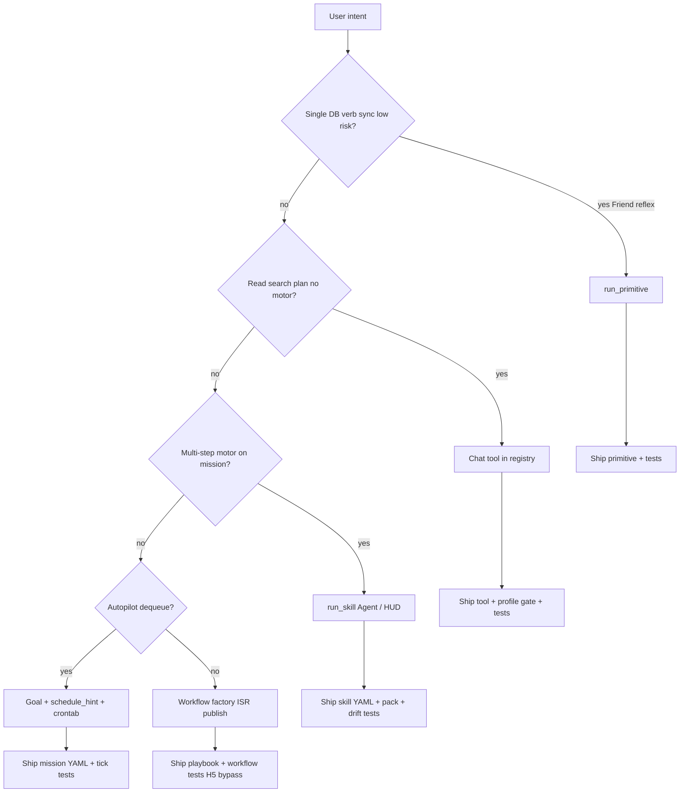

# Tool extension guide

Operator + implementer checklist for extending ADA without violating entity bucket invariants. Read [ADA_ENTITY_BUCKETS.md](ADA_ENTITY_BUCKETS.md) first.

Use-case specs: [use_cases/README.md](use_cases/README.md) · Memory writes: [MEMORY_OPS.md](MEMORY_OPS.md).

---

## A. Decision tree

**Routing examples** (harness — [`format_concierge_routing_note`](../src/ada/prompt.py)):

| Operator intent | Layer |
|-----------------|--------|
| “Remember …”, todos, body check | `run_primitive` |
| Vague research, profile status | Chat tools (`search_knowledge`, snapshots) |
| Ingest, publish, tick, motor skill | Agent `run_skill` or Run action — **not** Chat |
| Factory / ISR pipeline | Workflow enqueue — not H5-gated |

---

## B. Capability ladder

| Layer | When | Chat | Agent | Validation location | Registry |
|-------|------|------|-------|---------------------|----------|
| **Primitive** | Single DB verb, sync, low risk | `run_primitive` | No | [`primitives/catalog.py`](../src/ada/primitives/catalog.py) + [`handlers.py`](../src/ada/primitives/handlers.py) | Closed `PRIMITIVE_IDS` |
| **Chat tool** | Read/search/plan, no motor | direct tools | No | [`tools/registry.py`](../src/ada/tools/registry.py) + env gates | [`chat_capability.py`](../src/ada/chat_capability.py) profiles |
| **Skill** | Multi-step motor | No | `run_skill` | `skills/*.yaml` + pack allowlist | [`hands_catalog.json`](hands_catalog.json) |
| **Goal/cron** | Autopilot dequeue | No | via tick/daemon | mission `schedule_hint_json` | operator crontab |
| **Workflow** | Factory / ISR | No | enqueue paths | playbooks | not H5-gated ([HANDS_CONTRACT](HANDS_CONTRACT.md) bypass) |

**Order:** primitive → skill → goal/cron → workflow. Do not skip layers without justification in a use-case spec.

---

## C. Memory bucket picker

| Data | Write path | Read in Chat |
|------|------------|--------------|
| Personal note | `log_memory` → `ada://memory/base` | `recall_memory` |
| Standing voice | `append_soul_fragment` / `ada dream` | injected files |
| Global kernel | `add_knowledge_source`, `ada ingest-rss` | `search_knowledge` |
| Mission graph | Work / workflows | `get_entity_graph_context` (mission scope in Work) |

Contract: [MEMORY_CONTRACT.md](MEMORY_CONTRACT.md). Operator tags: [MEMORY_OPS.md](MEMORY_OPS.md).

---

## D. File touch list per extension type

### Primitive

| Action | Files |
|--------|--------|
| Add spec | `src/ada/primitives/catalog.py` |
| Implement | `src/ada/primitives/handlers.py` (arg aliases here only) |
| Chat allowlist | `src/ada/chat_capability.py` (`PRIMITIVE_ALLOWLIST`) |
| Tool schema | `src/ada/tools/registry.py` (`_run_primitive_declaration`) |
| Routing note | `src/ada/prompt.py` (`format_concierge_routing_note`) — intent only, not aliases |

**Tests:** `tests/test_primitives_*.py`, `tests/test_run_primitive.py`, `tests/test_chat_primitives.py`

### Chat tool

| Action | Files |
|--------|--------|
| Declaration | `src/ada/tools/registry.py` |
| Profile gate | `src/ada/chat_capability.py`, `src/ada/config.py` (env flags) |
| Orchestrator wiring | `src/ada/orchestrator.py`, `src/ada/tool_executor.py` as needed |

**Tests:** `tests/test_h3_chat_surface.py`, `tests/test_entity_work_regression.py`

### Skill

| Action | Files |
|--------|--------|
| Skill YAML | `skills/<id>.yaml` |
| Pack allowlist | `src/ada/programme/packs.py` |
| Catalog drift | `docs/hands_catalog.json` via `scripts/generate_hands_catalog.py` |
| Mission template | `templates/missions/*.yaml` (`skills_enabled`) |

**Tests:** `tests/test_hands_catalog_drift.py`, `tests/test_skills_enabled_enforcement.py`, `tests/test_programme_apply.py`

### Goal / cron

| Action | Files |
|--------|--------|
| Schedule hints | `templates/missions/*.yaml` (`schedule_hint_json`, `recommended_cron`) |
| Tick logic | `src/ada/mission_tick.py`, `src/ada/daemon_goal.py` |

**Tests:** `tests/test_mission_tick.py`

### Workflow

| Action | Files |
|--------|--------|
| Playbook / kind | `src/ada/workflow/templates.py`, playbooks under repo workflow paths |
| Enqueue | CLI / `enqueue_workflow` paths (bypass H5) |

**Tests:** grep `enqueue_workflow` under `tests/` (e.g. workflow and publish tests)

---

## E. Harness rules

1. **LLM routes; Python validates** — closed `primitive_id` in `PRIMITIVE_IDS`; `args_json` shaped by catalog + handler coercion.
2. **Entity Chat:** never `run_skill`; never invent counts for `body_check` or snapshots.
3. **Arg aliases** live in `handlers.py` only — e.g. `log_memory`: `text`→`content`; `add_task`: `task`→`goal`; `recall_memory`: `q`→`query`. Document in specs; do not duplicate full alias tables in prompt prose.
4. **Plan mode:** templates only; no invented workflow kinds.
5. **Lab → Friend:** operator-approved `log_memory` + tags — not automatic merge.

---

## F. Anti-patterns

| Anti-pattern | Why wrong | Prefer |
|--------------|-----------|--------|
| New mission per habit | Violates hat = programme | Primitive + tags or Friend todo |
| Chat `enqueue_workflow` | Bypasses concierge contract | Agent skill or operator CLI |
| Mega-cron “learn everything” | No programme boundary | NULL ingest + Lab slug |
| 20 ad-hoc Chat tools | Unvalidated surface | One primitive or one skill |
| Silent graph→base merge | Breaks memory contract | `lab-summary` + `log_memory` |
| Broad `ada consolidate` | Out of K0 / entity scope | Explicit operator bridge |
| Matrix/GSC on `ada_ops` | House scope | Lab mission `gsc_site_url` |
| Skip ladder (workflow first) | Hard to test and route | Document justification in use-case spec |

Bucket map: [ADA_ENTITY_BUCKETS.md](ADA_ENTITY_BUCKETS.md).
