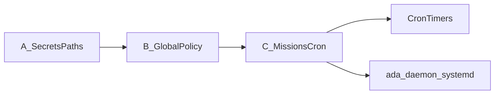

# Operator Pi bundle: tiers and file ownership

This doc maps **three configuration tiers** to the files ADA reads on disk. Day-to-day copy-paste lives in [`CHEATSHEET.md`](CHEATSHEET.md). Full Raspberry Pi cron, systemd, and publisher tracks are in [`operator-runbook-raspberry-pi.md`](operator-runbook-raspberry-pi.md).

## Tier summary

| Tier | What it owns | Primary locations |
|------|----------------|-------------------|
| **(A) Secrets / paths** | API keys, database location, profile isolation | Repo **`.env`** (from [`.env.example`](../.env.example)); **`ADA_PROFILE`** + **`ADA_PROFILE_DATA_ROOT`**; or **`ADA_DATA_DIR`** / **`ADA_COMMERCIAL_DATA_DIR`**; AWS/S3 (**`AWS_*`**, **`S3_*`**); **`GEMINI_API_KEY`**; optional **`GSC_*`**, **`DATAFORSEO_*`**, **`ADA_SERPER_API_KEY`** |
| **(B) Global policy** | Numeric rails and model-facing intent | [`policies/default.yaml`](../policies/default.yaml); optional **`ADA_POLICY_PACK`** / **`ADA_POLICY_ROOT`**; [`memory/intent.md`](../memory/intent.md) plus other [`memory/`](../memory/) files as documented in the README |
| **(C) Missions + cron** | Programme defaults, tick hints, wall-clock automation | SQLite **`missions`** via **`ada mission`** ([`operator-onboarding.md`](operator-onboarding.md)); [`playbooks/registry.yaml`](../playbooks/registry.yaml); **`crontab`** / **systemd** — [`operator-runbook-raspberry-pi.md`](operator-runbook-raspberry-pi.md), [`ops/schedule.md`](../ops/schedule.md); thin wrappers in [`scripts/pi/`](../scripts/pi/) |

**Rule of thumb:** put site-specific knobs in **mission `defaults_json`** (tier C); keep **tier B** to global numeric limits only; keep secrets and paths in **tier A** (`operator-onboarding.md` deprecation map lists env vars to migrate).

## Related

- [`CHEATSHEET.md`](CHEATSHEET.md)
- [`operator-onboarding.md`](operator-onboarding.md)
- [`operator-runbook-raspberry-pi.md`](operator-runbook-raspberry-pi.md)
